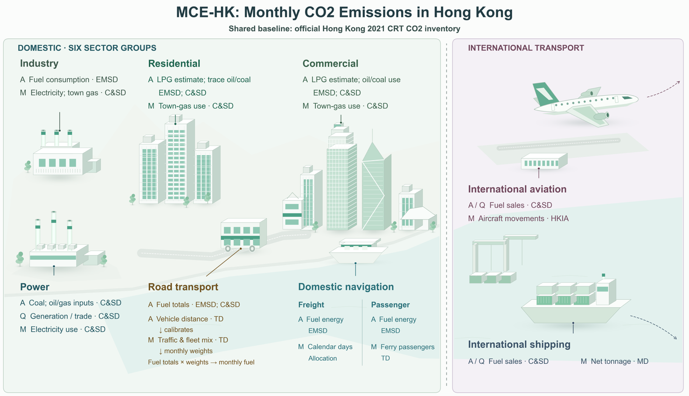

# MCE-HK: Monthly CO₂ Emissions in Hong Kong

**MCE-HK** provides monthly combustion CO₂ emission estimates for Hong Kong, with eight sector accounts, a shared 2021 inventory baseline and model-based uncertainty intervals.

项目覆盖电力、工业、道路及剩余运输、本地航运、居民、商业，以及国际航空和航运供油。代码按原始数据获取、基准与部门映射、分部门公式、校准汇总、不确定性和检验组织。主结果单位为 **ktCO₂**。

[Code repository](https://github.com/zhudeng94/MCE-HK) · [Interactive atlas](https://carbon-hk.iearth.hk) · [Methods](docs/sectors.md) · [Reproduction](docs/reproduction.md)

## 论文图示

**图 1 · MCE-HK 核算框架**

以 2021 年香港 CRT 清单为统一基准，连接各部门的年度／季度统计约束和月度活动代理。



**图 2 · 香港月度 CO₂ 排放**

六个本地部门与国际航空、航运供油的月度排放、同比变化及近期分部门结果。黑色虚线标示本地合计，阴影表示模型 95% 区间。


图号沿用当前修订稿；图件来源与 SHA-256 记录在 [图件来源清单](docs/figures/provenance.json)。

## 维护入口

| 要维护什么 | 从哪里开始 |
|---|---|
| 原始数据下载地址、发布机构 | [来源目录](configs/sources.json)、[下载与导入](docs/acquisition.md) |
| 当前复现必需输入 | [输入合同](configs/required_inputs.json) |
| CRT 类别、工作表、基准和部门边界 | [部门映射](configs/sector_mapping.json)、[基准说明](docs/benchmarks.md) |
| 电力、工业、建筑、运输、国际供油公式 | [分部门公式](docs/sectors.md)、[计算模块](src/cmhk/sectors/) |
| 排放因子、时间范围、代理方法 | [计算参数](configs/model.json) |
| 不确定性分布、随机种子、抽样次数 | [不确定性参数](configs/uncertainty.json) |
| 运行步骤与检查 | [复现指南](docs/reproduction.md) |
| 目录、依赖方向和修改顺序 | [工程结构](docs/architecture.md) |

## 根目录

```text
MCE-HK/
├── README.md                 项目说明与维护入口
├── pyproject.toml            安装、依赖与测试配置
├── configs/                  方法参数、来源目录、部门映射、依赖版本
├── src/cmhk/                 排放计算包
├── tests/                    计算测试与样例
├── docs/                     现行方法与维护文档
├── scripts/                  复现、来源清单和可选代码导出
├── data/                     本地输入及标准化缓存（Git 忽略）
├── outputs/                  计算结果（Git 忽略）
└── local/                    网站、部署、研究、旧版本（Git 忽略）
```

GitHub 上传范围直接由 `.gitignore` 控制，日常不需要另建导出仓库。`scripts/daily_update.sh` 仅为现有定时任务保留转发入口，并由 Git 忽略。

## 安装与运行

Python 3.10+。从代码目录创建环境并安装：

```bash
python -m venv .venv
source .venv/bin/activate
python -m pip install -r configs/requirements.txt
python -m pip install -e . --no-deps

cmhk fetch --list
# 下载支持的公开来源；CRT、CEIC及两电资料汇编还需按获取说明导入
cmhk fetch
cmhk check-inputs
cmhk run --test
```

已有当前版本原始数据时，直接运行 `cmhk check-inputs` 和 `cmhk run --test`，不必刷新下载。也可从源码运行 `PYTHONPATH=src python -m cmhk run --test`，或兼容入口 `python scripts/reproduce.py --test`。

核心流程完全使用 Python 和缓存输入，生成月度部门表、月度/年度总量、不确定性、来源记录和对外月度 CSV。报告和外部比较分别通过 `--report`、`--comparisons` 启用。逐步执行见复现指南。

## 方法与结果

生产基准统一为 **2021 CRT**；2005、2020 为留出核对年。各部门的年度/季度活动刻画变化、月度活动确定分布。主表发布八部门：电力、工业、道路及剩余运输、本地航运、居民、商业、国际航空供油、国际航运供油。

- `outputs/hong_kong_sector_monthly.csv`：月度八部门，含方法、暂估身份和基准。
- `outputs/hong_kong_total_monthly.csv`、`hong_kong_total_annual.csv`：两种合计范围、有效月份和同月同比。
- `outputs/uncertainty/`：固定种子的模型 95% 区间及联合汇总。
- `outputs/publication/MCE_HK_monthly.csv`：月度数据产品，八部门及本地合计。
- `outputs/diagnostics/sector_benchmarks.csv`：CRT 文件、工作表、单元格和哈希。
- `outputs/provenance/`：阶段状态、参数及代码/输入哈希。

覆盖时间随来源更新，以结果表及生成的 publication README 为准。空白为缺失；只有范围内各部门完整时才生成合计；不足十二个月的年度值保留部分年身份，不作年化。

Road Transport 包括完整 1.A.3 扣除本地航运后的剩余类别。国际供油按香港供应燃料口径单列。本地六部门合计为所覆盖燃烧范围，不能替代完整地域温室气体清单。95% 区间条件于明确的误差分布及结构假设。

## 测试与代码发布

```bash
# 无生产数据的算法测试
python -m pytest -q -m 'not integration and not comparison and not research'
# 有数据时运行核心复现及回归检验
cmhk run --test
# 生成可审阅的 GitHub 代码目录
python scripts/export_code.py --destination /tmp/cmhk-code-release
```

代码导出遵循 `.gitignore`，包含 `src/cmhk/`、配置、测试样例和现行文档。`local/` 集中保存网站、部署、卫星研究及历史材料。`data/`、`outputs/` 和 `.tmp/` 分别保存本地数据、结果和运行状态，均由 `.gitignore` 排除。导出目录附有逐文件 SHA-256 清单，此导出用于提供副本；日常直接在当前项目中使用 Git，`.gitignore` 自动排除本地材料。

原始数据的配套版本、CEIC 获取/分发权限和 CRT 原始来源记录见 [来源说明](docs/data_sources.md)。代码许可证、作者与引用标识仍需由项目负责人确定，当前未添加未经确认的许可证或 DOI。见 [发布准备](docs/publication.md)。

整理前快照、迁移关系及结果比对见 [整理验证](docs/cleanup_verification.md)。
