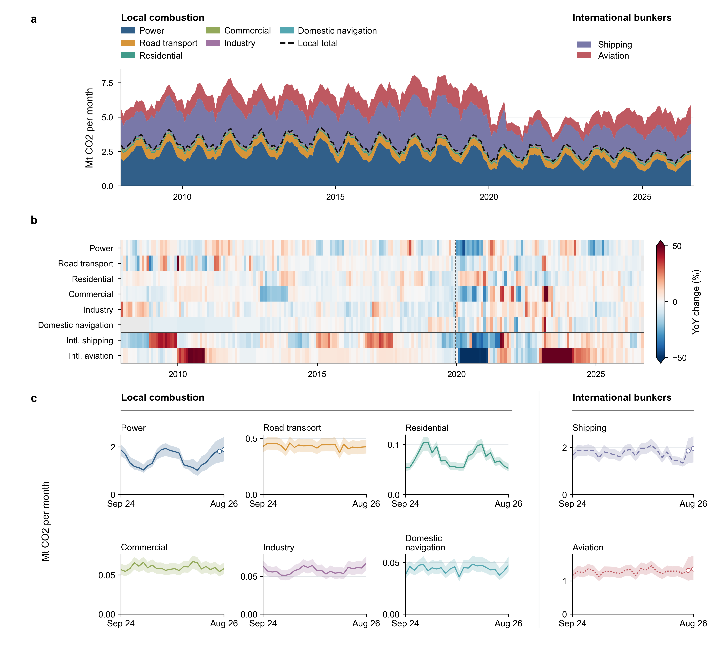

# MCE-HK: Monthly CO₂ Emissions in Hong Kong

MCE-HK estimates monthly combustion CO₂ emissions for six local sectors and international aviation and shipping, using a shared 2021 inventory baseline and model-based 95% uncertainty intervals.

[Download data](results/MCE_HK_monthly.csv) · [Data description](results/README.md) · [Interactive atlas](https://carbon-hk.iearth.hk)

## Data

The [monthly dataset](results/MCE_HK_monthly.csv) contains eight sector accounts and the local total, with lower and upper 95% interval bounds, in **kt CO₂**. All accounts are available from January 2008 to August 2026; individual accounts extend further. See the [data description](results/README.md) for coverage and accounting boundaries.

## Figures

**Figure 1. MCE-HK accounting framework.**


**Figure 2. Monthly emissions, year-on-year changes and recent sector estimates.** Shading shows 95% model intervals; the dashed boundary marks the local total.



## Reproduce

Python 3.10 or later:

```bash
pip install -e .
cmhk fetch
cmhk run
```

Reproduction also requires the CRT workbooks, historical CEIC input and utility-generation compilation listed in [the input requirements](configs/required_inputs.json). Model parameters, sector mappings and uncertainty settings are in `configs/`. The published CSV can be used directly without these inputs.
